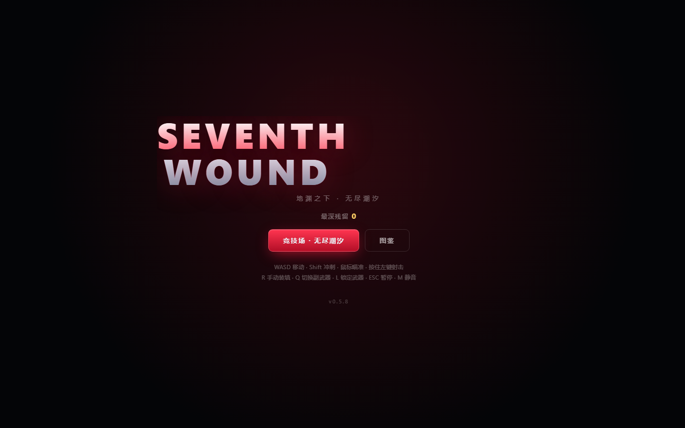
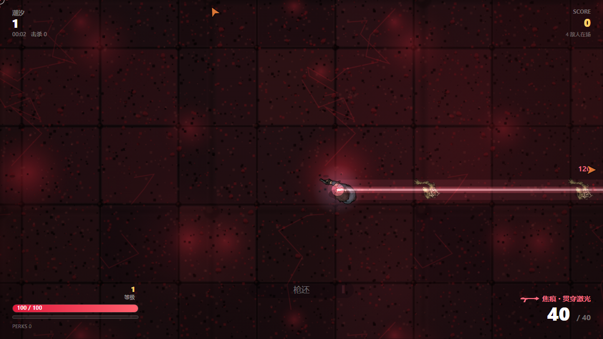
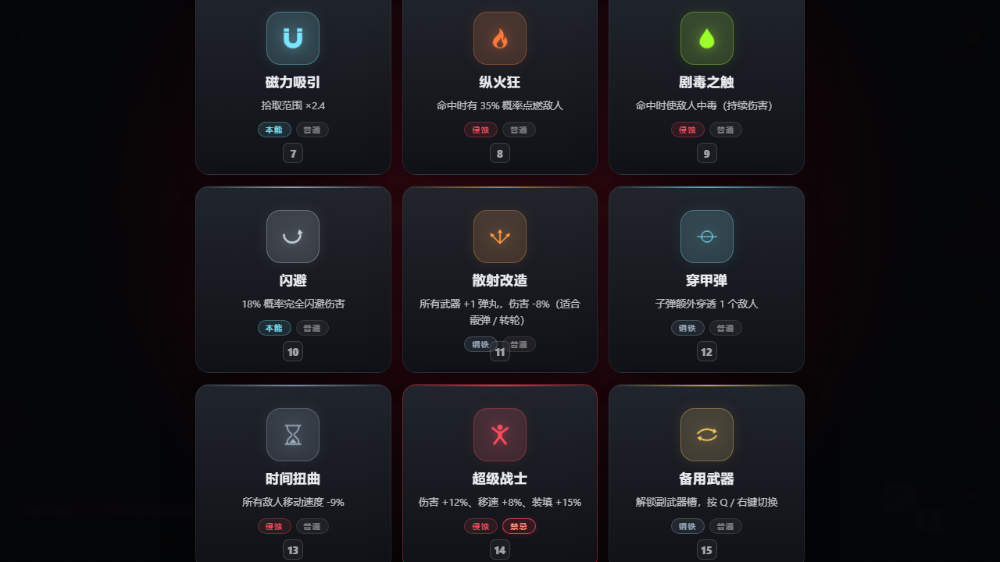
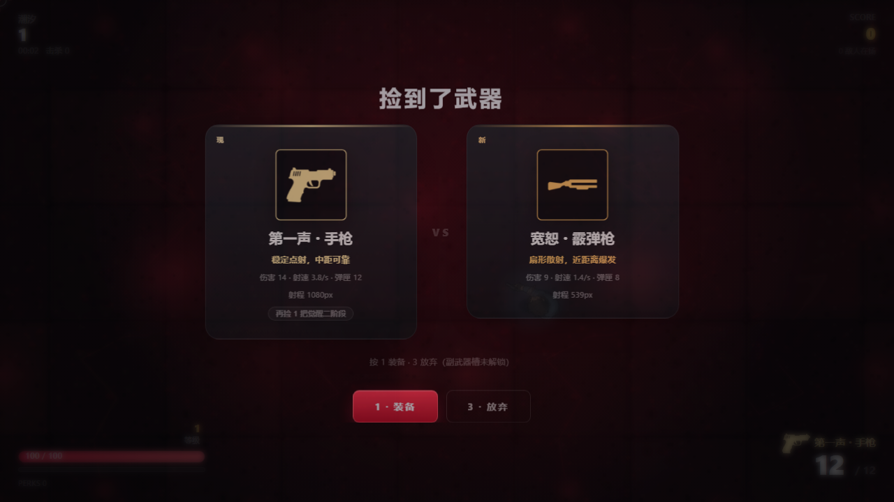
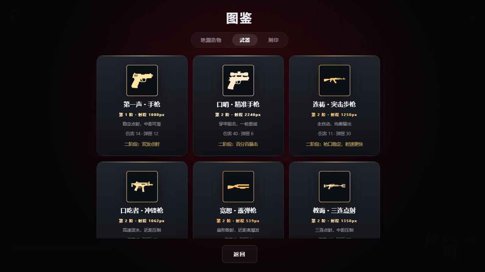

# SEVENTH WOUND · 第七道伤

俯视角竞技场射击（Crimsonland / 血腥大地 风格的浏览器复刻）。
**零依赖、零构建、单文件 700 KB，双击即玩。**

**[▶ 在线试玩](https://blackq166s-web.github.io/SEVENTH_WOUND/)**



---

## 这是什么

一局**无尽生存**：地渊之下，潮汐一波波涌来，你只有一条命。

- **波次推进** — 每 24 秒推进一波，敌人血量 +13% / 伤害 +6% / 速度 +1.5%，每 5 波出现守层者
- **刻印三选一** — 升级时从 25 个刻印中选一个，分钢铁 / 本能 / 侵蚀三条路线
- **武器二阶段** — 17 把枪，捡到**同款第 2 把**会觉醒独特质变（霰弹弹丸翻倍、狙击必暴、激光贯穿全屏…）
- **侵蚀代价** — 侵蚀线刻印会累积侵蚀值，越高心跳越快、台词越不像人
- **图鉴** — 敌人 / 武器 / 刻印全收录，含射程与二阶段说明



### 更多界面

| 刻印三选一（升级） | 武器对比（捡枪） |
| --- | --- |
|  |  |



---

## 快速开始

### 方式一：在线玩

**<https://blackq166s-web.github.io/SEVENTH_WOUND/>**

推送 `main` 自动部署（GitHub Actions），细节见 [`DEPLOY.md`](DEPLOY.md)。

### 方式二：下载单文件（推荐分享给朋友）

从 Releases 下载 `SEVENTH-WOUND-<version>.html`，**双击用 Chrome / Edge 打开即可**。
不装东西、不联网、不开服务 —— 整个游戏（含美术与音效）都在这一个文件里。

### 方式三：本地开发

```bash
cd 03_项目实现
start.bat                 # Windows 一键起服务并打开浏览器
# 或者：
node tools/serve.mjs 8123
```

打开 <http://127.0.0.1:8123/>。

手机真机预览时，先运行 `node tools/pack.mjs`，再运行 `node tools/serve.mjs 8123 --lan`。手机与开发机接入同一局域网，在手机浏览器打开开发机的局域网 IP 和端口 8123。预览入口提供当前的单文件打包产物。

使用已有静态站点测试时，可把打包的 `release/SEVENTH-WOUND-<version>.html` 放到静态发布目录，命名为 `index.html`。手机打开站点后可在首页确认版本号。

> **必须走 http**。直接双击 `index.html`（`file://`）会因 ES Module 跨域被浏览器拦下。
> 需要 Node.js 18+（仅用于本地静态服务与验证脚本，游戏本身不依赖 Node）。

---

## 操作

手机横竖屏均可战斗。左摇杆移动，右摇杆向外推来瞄准并射击。空仓自动装填，右上角小图标可暂停，装备副武器后可在暂停菜单换枪。旋转手机时保留当前对局，松手后重新推动摇杆即可。

支持全屏的手机浏览器会在点「竞技场」时进入全屏。iPhone 标签页保留浏览器工具栏时，可用浏览器提供的「添加到主屏幕」选项，再从主屏幕打开。

| 按键 | 作用 |
| --- | --- |
| `W A S D` | 移动 |
| `Shift` | 冲刺（短暂无敌） |
| 鼠标 | 瞄准 / 左键射击（按住连发） |
| `R` | 手动装填 |
| `Q` | 切换副武器 |
| `L` | 锁定 / 解锁当前武器（锁定后捡到更好的枪不会自动换） |
| `1` `2` `3` | 升级时选刻印 / 捡枪时 替换 · 放入副武器槽 · 保留 |
| `ESC` | 暂停 |
| `M` | 静音 |

---

## 技术特点

| 项 | 说明 |
| --- | --- |
| 运行时依赖 | **零**。只用浏览器原生 API，无框架、无打包器、无 npm install |
| 构建 | **无**。ES Module 直接跑，改完刷新即生效 |
| 产物 | 单个 HTML，约 700 KB（角色 7 张 + 武器 17 张 + 刻印 25 张 PNG 全部 base64 内联） |
| 美术 | 程序化生成 + PNG 素材（可覆盖），加载失败自动回落矢量绘制 |
| 音效 | WebAudio 实时合成，无音频文件 |
| 时间步长 | 固定 1/60，逻辑与渲染分离（`update*` 不碰 ctx，`render` 不改状态） |
| 可复现 | `?seed=xxx` 固定随机流，同 seed 每局完全一致（用于调参与回归） |

源码约 **7.4k 行**，21 个模块：

```
src/core/     math · camera · input · audio · fx          底层设施
src/game/     game · player · enemies · weapons · perks   玩法逻辑
              hud · voice · particles · decals · threats
src/render/   sprites · palettes                          渲染与美术生成
src/ui.js     DOM 面板（菜单 / 刻印 / 武器 / 图鉴 / 结算）
```

---

## 开发与验证

**每次改动都要跑对应门槛**（详见 `AGENTS.md` 第 5 节）：

```bash
node 03_项目实现/tools/smoke.mjs          # 无头冒烟 → SMOKE_OK + 功能校验 PASS
node 03_项目实现/tools/determinism.mjs    # 同 seed 三遍复现 → DETERMINISM_OK
node 03_项目实现/tools/shoot.mjs          # 真浏览器截图（需先起 8124 服务）
node 03_项目实现/tools/pack.mjs           # 打包单文件 → release/
```

| 改动类型 | 必跑 |
| --- | --- |
| 任何逻辑改动 | `smoke.mjs` |
| 改随机源 / 玩法数值 | `+ determinism.mjs` |
| 表现 / 渲染改动 | `+ shoot.mjs`（人工看截图） |

版本号唯一真源是 `03_项目实现/package.json`；`index.html` 里的 `#verLine` 必须与之一致，`pack.mjs` 会校验并在不一致时报错。

---

## 上手改代码

- **加武器 / 刻印 / 敌人** → 只改数据表，不动 `game.js`：
  `src/game/weapons.js` · `src/game/perks.js` · `src/game/enemies.js`
- **改 UI 面板** → `index.html`（结构与样式）+ `src/ui.js`（填充逻辑）
- **换美术** → 三份规范在 `03_项目实现/docs/`：
  `角色精灵生成规范.md` · `武器图标生成规范.md` · `刻印图标生成规范.md`
- **完整模块地图与扩展点** → [`03_项目实现/docs/ARCHITECTURE.md`](03_项目实现/docs/ARCHITECTURE.md)

### 给 AI Agent 的入口

本仓库按「AI Agent 长期接手」的方式组织，接手时依次读：

1. **`AGENTS.md`** — 执行规则、权限边界、验证门槛、技术铁律（**必读**）
2. **`STAGE.md`** — 当前阶段目标 / 进展 / 阻塞 / 下一步
3. **`01_阶段成果/当前总结.md`** — 滚动总结：关键结论、踩坑记录、遗留问题
4. **`03_项目实现/docs/ARCHITECTURE.md`** — 模块职责与数据流

---

## 目录结构

```
AGENTS.md                    执行规则与权限边界（Agent 必读）
STAGE.md                     当前阶段：目标 / 进展 / 阻塞 / 下一步
README.md                    本文件
DEPLOY.md                    推送到 GitHub + Pages 部署的完整步骤
LICENSE                      MIT

01_阶段成果/
  当前总结.md                 滚动总结（结论 + 证据 + 踩坑）
  YYYYMMDD_名称/              历史快照（含当时的总结、截图、版本索引）

02_输入材料/                  原始需求与参考资料（只增不改）

03_项目实现/                  ← 代码全部在这里，自成闭环
  index.html                 页面骨架 + 全部 CSS
  package.json               版本号唯一真源
  start.bat                  Windows 一键启动
  src/                       源码（见上方模块表）
  tools/                     验证与打包脚本（只用 Node 内置模块）
  assets/                    PNG 素材：sprites 7 / weapon-icons 17 / perk-icons 25
  docs/                      设计文档、素材规范、ARCHITECTURE.md、images
  shots/                     验证截图（不入库，跑 shoot.mjs 重生成）
  release/                   打包产物（不入库，跑 pack.mjs 重生成）

_staging/YYYYMMDD_事项/      草稿与临时材料（不入库）
SECRETS.local.md             本地敏感信息（不入库）
```

> ⚠️ `03_项目实现/` 自成闭环：`start.bat`、`serve.mjs` 的 ROOT、验证脚本的相对 import 都与它的位置绑定。
> **不要把这个目录里的单个文件搬到仓库根**，否则脚本全会失效。

---

## 当前状态

**v0.6.2** — 手机横竖屏适配版，战斗界面使用双摇杆和暂停图标，待真机验收。
下潜模式已停用（代码保留，可回退）。详细进度见 `STAGE.md`。

CI 每次推送自动跑 `smoke` + `determinism` + 版本一致性校验；`main` 分支同步部署到 Pages。

---

## License

[MIT](LICENSE)
